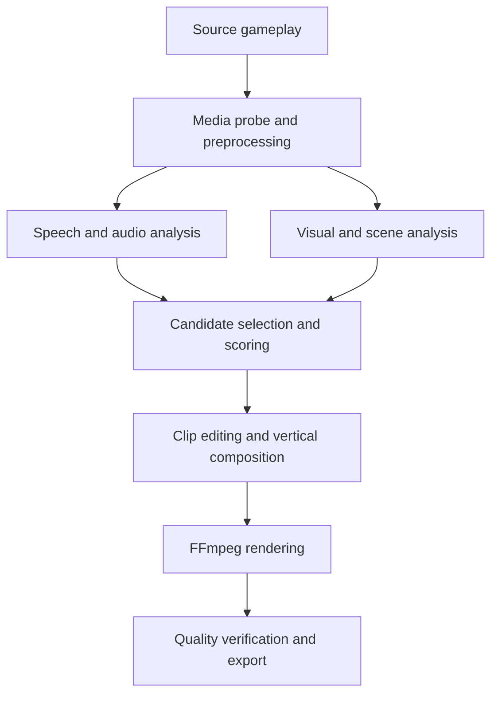

<div align="center">

# GTA Reel Studio

**AI-assisted highlight detection and automated short-form video editing for GTA VI (GTA 6) gameplay, with GTA V support.**

Convert long gameplay recordings into ready-to-review vertical videos for Instagram Reels, YouTube Shorts, and TikTok.


[](LICENSE)

[Overview](#overview) · [Quick Start](#quick-start) · [Usage](#usage) · [Architecture](#architecture) · [Troubleshooting](#troubleshooting) · [License](#license)

</div>

---

## Overview

GTA Reel Studio is a reusable agent skill for Google Antigravity that analyzes long Grand Theft Auto VI (GTA 6) and Grand Theft Auto V (GTA 5) gameplay recordings, identifies compelling moments, and produces short-form video content through a locally executed editing pipeline.

The skill combines speech transcription, audio signals, visual analysis, and editorial scoring to identify moments with strong hooks, authentic reactions, meaningful context, and entertaining payoffs.

The primary target is GTA VI content creation; the existing GTA V workflow remains supported. The same media-based analysis operates on authorized local recordings without game-specific APIs. GTA VI-specific behavior should be validated against actual gameplay footage before claiming end-to-end compatibility.

The repository intentionally contains only the skill and project documentation. Processing scripts, dependencies, analysis artifacts, and video files are generated locally when required.

## Features

| Capability | Description |
| --- | --- |
| Intelligent highlight detection | Detects funny moments, excitement, frustration, stunts, close calls, mission outcomes, and unexpected gameplay events. |
| Multimodal analysis | Combines timestamped transcripts, audio energy, visual evidence, and facecam reactions where available. |
| Editorial ranking | Scores candidate clips using hook strength, emotion, surprise, narrative quality, readability, and shareability. |
| Automated editing | Selects suitable 30–60 second segments and adjusts pacing, framing, and audio. |
| Vertical composition | Preserves important gameplay through intelligent cropping, fitted layouts, or facecam composition. |
| Captions and hooks | Generates synchronized subtitles and concise opening hooks while preserving the original language. |
| Publishing assets | Produces video covers, captions, relevant hashtags, and clip reports. |
| Quality assurance | Verifies output format, duration, playback, and visual/audio quality where supported. |
| Local-first processing | Preserves original recordings and reuses existing analysis to reduce repeated work. |

## Quick Start

### Option A — Install with Skills.sh (recommended for existing workspaces)

Install the skill directly into an existing Antigravity workspace using the [Skills CLI](https://skills.sh/). This requires a compatible Node.js installation (22.20 or later), plus `npm`/`npx`.

Open a terminal in your workspace and run:

```bash
npx skills add Abhishek6353/GTA-Reel-Studio --skill gta-reel-editor -a antigravity
```

To inspect the available skill before installing:

```bash
npx skills add Abhishek6353/GTA-Reel-Studio --list
```

Review the skill and installation prompt before confirming. The CLI installs it at project scope by default. Open the workspace in Antigravity, create `input/`, add your gameplay recording, and follow the [run instructions](#4-run-the-skill) below.

The Skills CLI also supports agents such as Codex and Claude Code. GTA Reel Studio has been used with Antigravity; other agent environments and GTA VI footage require independent workflow testing.

### Option B — Clone the repository

Use the following approach if you want a dedicated GTA Reel Studio workspace without the Skills CLI.

### Prerequisites

- Google Antigravity with access to a compatible agent model and terminal execution.
- Git and access to this public repository.
- Sufficient local disk space for source recordings, analysis, and rendered clips.
- Permission to install missing free dependencies and download local speech recognition models.

Python, FFmpeg, and additional processing dependencies are detected and configured by the agent when possible. Installation requirements vary by operating system.

### 1. Clone the repository

```bash
git clone https://github.com/Abhishek6353/GTA-Reel-Studio.git
cd GTA-Reel-Studio
```

### 2. Add gameplay recordings

Create the `input/` directory and place your gameplay files inside it.

```bash
mkdir input
```

Supported input formats include MP4, MOV, MKV, and WEBM, subject to local codec support.

### 3. Open the workspace

Open the cloned `GTA-Reel-Studio` directory in Antigravity.

The agent skill is located at [`.agents/skills/gta-reel-editor/SKILL.md`](.agents/skills/gta-reel-editor/SKILL.md).

### 4. Run the skill

Send the following prompt to Antigravity:

```text
Use the gta-reel-editor skill.

Process my GTA VI gameplay videos in input/ using quality mode.
Set up any missing free dependencies, analyze the entire recording,
and generate up to 5 high-quality, distinct 30–60 second vertical reels.

Preserve my original commentary, add accurate subtitles and engaging
hooks, and intelligently reframe the gameplay into 9:16.

Render and verify the final videos. Execute the complete workflow.
```

Approve required installation or terminal permissions when prompted. The first run may take longer because tools, models, and processing scripts may need to be initialized.

### 5. Review the exports

The final videos and associated publishing assets are saved under `output/`. Review the generated clips before uploading them.

## Usage

Once configured, invoke the skill with a short prompt for each new recording.

| Mode | Description | Example prompt |
| --- | --- | --- |
| Standard | Full analysis, ranking, rendering, and verification. | `Use gta-reel-editor. Process the new video in input/.` |
| Quality | Deeper visual inspection, refined captions, framing, and timing. | `Use gta-reel-editor in quality mode. Generate the best 5 reels.` |
| Fast | Reduced analysis overhead and up to three clips. | `Use gta-reel-editor in fast mode.` |
| Analysis only | Ranked candidates and previews without final video rendering. | `Use gta-reel-editor. Analyze the footage without rendering.` |

The skill adapts its analysis to the actual game footage. For GTA V recordings, simply specify GTA V (or let the agent identify the game from evidence). It does not assume a fixed GTA VI HUD or mission structure.

Customize the workflow through natural-language instructions:

```text
Use gta-reel-editor in quality mode.
Generate the best 3 reels, 35–45 seconds each.
Preserve my Hindi/Hinglish commentary and use Roman Hindi captions.
Prioritize GTA VI funny fails, police chases, unexpected events,
and emotional reactions. Avoid spoilers in titles and captions.
```

The skill can also accept preferences for caption style, branding, facecam layout, audio, clip count, and duration.

## Architecture



### Highlight scoring

| Criterion | Weight |
| --- | ---: |
| Surprise, humor, skill, or unusual payoff | 25 |
| Opening hook | 20 |
| Creator emotion or gameplay tension | 20 |
| Narrative and payoff | 15 |
| Mobile readability | 10 |
| Shareability and replay quality | 10 |
| **Total** | **100** |

The default selection threshold is 75/100. Scores are editorial heuristics, not predictions of view counts. The agent may return fewer clips when suitable highlights are unavailable.

### Technology stack

| Component | Technology |
| --- | --- |
| Agent orchestration | Google Antigravity |
| AI analysis | Compatible multimodal agent model |
| Video processing | FFmpeg and FFprobe |
| Speech recognition | Faster Whisper or compatible local ASR |
| Automation | Python |
| Frame analysis | OpenCV or equivalent, when needed |

## Project Structure

```text
GTA-Reel-Studio/
├── .agents/
│   └── skills/
│       └── gta-reel-editor/
│           └── SKILL.md        # Agent skill definition
├── .gitignore                  # Repository exclusions
├── README.md                   # Project documentation
├── LICENSE                     # MIT license
├── input/                      # Source recordings (local)
├── output/                     # Rendered clips and reports (local)
├── work/                       # Analysis data and cache (local)
├── scripts/                    # Generated automation scripts (local)
└── .venv/                      # Python environment, if needed (local)
```

Only `SKILL.md`, `.gitignore`, `README.md`, and `LICENSE` are version-controlled. All processing directories are local and may be created automatically by the agent.

## Output Format

| Parameter | Default |
| --- | --- |
| Resolution | 1080 × 1920 |
| Aspect ratio | 9:16 |
| Clip duration | 30–60 seconds |
| Video codec | H.264 |
| Audio codec | AAC |
| Container | MP4 |
| Frame rate | 30 or 60 FPS, when suitable |
| Subtitles | Burned-in when commentary is present |
| Language | Original recording language |

A typical output directory may contain:

```text
output/<source-id>/
├── 01-highlight.mp4
├── 01-highlight.jpg
├── 01-highlight.srt
├── 01-highlight.txt
├── REPORT.md
└── manifest.json
```

Each reel includes its source timestamps, selection rationale, and review status in the report. Subtitle files are generated when speech is present.

## Updating

For installations managed by the Skills CLI, run the following from your workspace:

```bash
npx skills update gta-reel-editor
```

For a cloned repository, use:

```bash
git pull origin main
```

Open the workspace in Antigravity, add new recordings to `input/`, and invoke the skill again.

Check the files tracked by Git with:

```bash
git ls-files
```

Do not commit recordings, rendered clips, environments, model files, intermediate artifacts, or API credentials.

## Troubleshooting

| Issue | Resolution |
| --- | --- |
| Skill is not detected | Confirm that the repository root is open in Antigravity and the skill is in the correct `.agents/skills/` directory. |
| FFmpeg is unavailable | Allow the agent to install it using a trusted package manager, or install it manually and rerun the skill. |
| No highlights are selected | Check whether the source contains suitable moments. Try quality mode or request analysis-only results. |
| Transcription is inaccurate | Provide clearer microphone audio or request a more capable local transcription model. |
| Gameplay is cropped incorrectly | Request a fitted layout or more conservative cropping and rerender the affected clip. |
| Processing is slow | Use fast mode, shorter recordings, or suitable hardware acceleration. |
| Visual analysis is unavailable | Review the agent's reported limitations and manually inspect the selected candidates before publishing. |

## Best Practices

- Prefer original, high-resolution footage over compressed downloads.
- Record commentary and game audio on separate tracks whenever possible.
- Avoid copyrighted background music and review in-game radio audio.
- Prioritize strong, distinct moments over a fixed number of clips.
- Review subtitles, framing, and rights or sensitivity flags before publishing.

## Limitations and Responsible Use

GTA Reel Studio is an agent-driven workflow rather than a standalone video editing application. Results depend on the quality of the recording, available model capabilities, installation permissions, and system performance. Viral performance is not guaranteed.

Use only footage and audio you are authorized to edit and publish. This is an independent community project and is not affiliated with Rockstar Games or Take-Two Interactive. The skill does not publish videos or upload source media to external services without explicit authorization.

## License

GTA Reel Studio is licensed under the [MIT License](LICENSE). Copyright © 2026 Abhishek Kurmi. Third-party tools, models, game footage, and other external assets remain subject to their respective licenses and rights.

## Maintainer

[Abhishek Kurmi](https://github.com/Abhishek6353)

---

<div align="center">

Built for creators who want to spend more time playing and less time editing.

</div>
